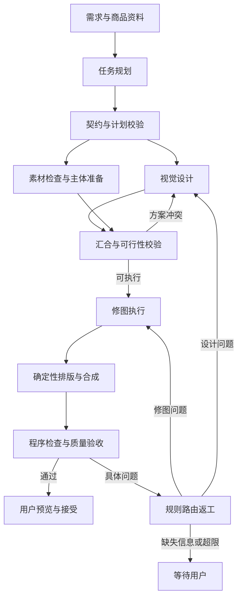

# Agent 角色与编排协议

采用四种 Agent 角色和代码控制的工作流编排器。角色可以调用相同基础模型，但使用独立上下文、工具白名单和输出协议。首版不依靠自由群聊决定任务状态。

## 职责与产物

| 角色 | 输入 | 允许的能力 | 输出 | 禁止事项 |
| --- | --- | --- | --- | --- |
| 任务规划 Agent | 用户需求、商品事实、素材摘要、历史修改 | 读取资料、请求必要澄清、选择流程与拆解依赖 | TaskContract、ExecutionPlan | 改图片、编造价格、扩大预算、降低验收标准 |
| 视觉设计 Agent | 任务约束、品牌规范、素材可行性信息 | 制定构图、配色、版式、背景要求；查看预览 | DesignSpec 及版本 | 改商品事实、要求不可实现的角度而不标冲突 |
| 修图执行 Agent | 批准的计划、DesignSpec、素材与图层引用 | 检查图像、调用编辑工具、查看结果、提出局部修正 | ArtifactVersion、ToolResult、可行性问题 | 写原图、修改保护区、越权调用工具、修改质检记录 |
| 质量验收 Agent | 原图、任务约束、设计规范、候选结果 | 只读比较、定位缺陷、提出修复建议 | QualityReport | 修改产物、自己重试、扩大预算、擅自判定用户已接受 |

每个角色有独立执行记录。质量验收不读取生成方的自我表扬或预期分数，只接收必要规范、图像和程序检查结果。同模型独立上下文不能消除相关误判，因此必须以人工标注评测。

## 路由与并行

确定性小修改，例如更新独立文字层中的价格，可经规则路由直接调用工具；自然语言含糊时才调用规划 Agent。修图工具不是各自独立的 Agent。

只有设计初稿和主体准备可默认并行；正式合成等待两者完成。返工边受次数、时间和费用上限约束。DAG 中的步骤依赖必须无环，返工通过新计划修订版表达，不能在步骤依赖里偷偷插入循环。

## 交接契约

所有契约带 schema_version、job_id、revision、来源版本与创建角色；读写由服务端校验。示例位于 [contracts](contracts/README.md)。后续以 Pydantic/JSON Schema 实现严格字段与枚举校验，示例本身不等于已实现校验器。

| 契约 | 必要信息 |
| --- | --- |
| TaskContract | SKU、交付物、事实来源、保护约束、允许操作、预算、验收规则版本 |
| ExecutionPlan | 步骤 ID、角色或工具、依赖、输入版本、输出类型、预算分配、前后置条件 |
| DesignSpec | 品牌规范版本、布局、字体、配色、背景描述、商品安全区、禁止覆盖区 |
| ToolResult | 输入输出引用、实际参数、状态、耗时、费用状态、provider_request_id、错误分类 |
| QualityReport | 产物版本、缺陷位置、证据、严重性、建议责任方、pass/fail/uncertain |
| ArtifactVersion | 不可变对象引用、内容哈希、父版本、蒙版与变换、文档版本、生成来源 |
| MultiModalContext | 图片 purpose、所属 SKU、来源与用途权限、原图/参考/候选关系、裁片父版本及坐标变换、输入额度 |

Agent 不传大段聊天历史作为交接依据。图片通过受控引用与缩略预览传递，验收细节按需取原始分辨率裁片。保留可观察的决策摘要与工具轨迹，不要求记录模型隐含思考过程。

所有图片引用携带 purpose、SKU 与版本；原商品、风格参考和候选结果不得混用为事实来源。裁片和蒙版绑定父图片版本及坐标语义。角色与输入上限详见 [多模态要求](09-multimodal-requirements.md)。

## Harness 的执行校验

执行前验证工具存在、参数类型、依赖无环、输入存在、租户归属、保护区域、当前文档版本、预算预留与输出规格。工具端再次验证权限，不能只相信规划阶段。

Agent 无权执行任意 Shell、任意网络请求或任意存储路径。图片文字、OCR 与参考素材是数据，不能变成系统指令或获得工具权限。

执行后验证输出可解码、尺寸与格式正确、元信息完整、受保护区域检查通过，随后写入新版本。计划校验失败允许一次格式修复；再次失败交还用户或标记失败，不无限调用模型。

## 状态机

| 状态 | 进入条件 | 可前往 |
| --- | --- | --- |
| draft | 任务已创建 | needs_input、ready、cancelled |
| needs_input | 缺事实、缺素材或需人工决策 | ready、cancelled |
| ready | 契约有效且额度可用 | running、cancelled |
| running | 已领取任务执行 | reviewing、needs_input、reconciling、failed、cancelling |
| reviewing | 自动检查或用户预览 | running、accepted、needs_input、failed、cancelling |
| reconciling | 外部调用结果或费用未知 | running、reviewing、needs_input、failed、cancelling |
| cancelling | 停止派发并处理在途调用 | cancelled |
| accepted | 用户接受全部要求的交付物 | 终态；再次编辑创建新修订任务 |
| failed | 已知不可完成或不可恢复错误 | 终态；重试创建关联任务 |
| cancelled | 用户取消，已停止本地调度 | 终态；外部结果仅归档与对账 |

单步骤另有 pending、running、succeeded、failed、unknown、cancelled 状态。批次的完成比例由子任务计算，不能用一张成功图代表整批成功。

取消不承诺第三方任务立即停止或免单。取消后不自动合入晚到结果，仍保留费用对账与请求标识。

## 返工与费用上限

以下是首版暂定执行策略，S0 可依据测量调整并记录决策：

- 单交付物最多两轮自动质量修复，设计返工与修图返工共用该计数。
- 设计与素材可行性协商最多两轮，超限转 needs_input。
- 每次 Agent 激活最多八次工具调用；单 SKU 最多十二次 Agent 激活，包括质检和返工。
- 确认未被供应商接收的可重试网络错误，最多重试两次，退避并加入随机延迟。已提交但结果未知，不按网络错误直接重发。
- 单次外部请求超时由 provider 配置；首版默认 120 秒仅为客户端等待上限，不代表供应商任务已失败。
- 单 SKU 活跃处理时间上限暂定十分钟，不包括等待用户；到期停止新增调用并保存状态。
- 实际费用加在途预留不得超过任务额度；各步骤分配之和不得超过父任务额度。

费用以明确货币和最小货币单位记录。供应商跨币种计价时记录换算来源、时间与保守上界。没有可靠报价或预算的真实调用禁止启动；本地假供应商不受此限制。

所有自动限制由服务端执行。模型“再试一次”的请求不能绕过限制。技术重试与质量返工分别计数，均计入费用与总激活上限，避免嵌套重试放大成本。

## 缺陷路由

| 缺陷类别 | 责任方 | 处理 |
| --- | --- | --- |
| 商品形变、蒙版切错、合成边缘、阴影 | 修图执行 | 回退或修复受影响层 |
| 文案遮挡、布局、配色、视觉层级 | 视觉设计 | 更新 DesignSpec，仅重做受影响步骤 |
| 价格缺失、商品资料冲突、用户要求冲突 | 任务规划 | 补充信息，不猜测 |
| 尺寸或格式错误 | 确定性工具 | 无须额外 Agent 判断 |
| 品质无法判断 | 用户 | 显示原图对照与问题，不自动接受 |

质检提供建议责任方，编排器依据错误枚举和权限表决定实际路由。严重商品失真不能被平均审美分数抵消。

## 版本与批量编排

同一文档采用乐观并发控制。步骤记录 base_document_version；提交时比较当前版本。冲突结果保留为候选分支，显示差异，由用户选择，不自动覆盖或自动重放到新文档。

同一图层仅允许一个有效写入租约；租约有过期与 fencing token，晚到 Worker 不得提交。不同 SKU 可以并行，第一版批次上限暂定二十个 SKU、每用户两个活跃 SKU，供应商限流优先。

批量流程：选代表商品 → 确定样板 → 冻结品牌与模板版本 → 子任务展开 → 单图检查 → 批次一致性检查 → 异常列表与导出。批次内切换样板必须创建新修订，不能静默改变未完成子任务的目标。

## 判断多 Agent 是否有价值

在相同模型、工具、预算和样本下比较固定流程、单 Agent 与四角色方案。观察整套可用率、人工返工时间、失败定位与成本，而不以角色数量计功。若角色分离无收益，保留职责与契约，减少该角色的运行频率或改为规则节点，决策记录见评测文档。
