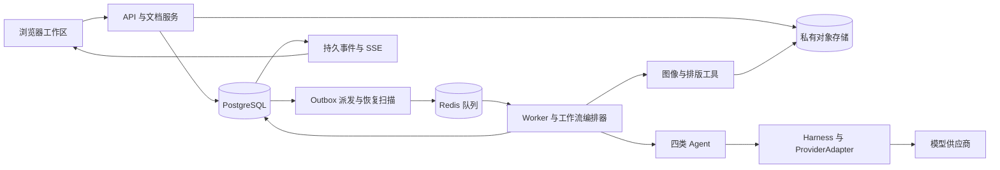

# 技术架构与选型

首版采用模块化单体 API、独立任务 Worker 和浏览器编辑器。四种 Agent 是逻辑角色，不分别部署成微服务。架构服务于非破坏编辑、任务恢复和批量交付。

下列选型为项目暂定基线；S0 验证依赖兼容性、模型可用性与出口一致性后锁定版本。未建立依赖锁文件前，不声称这套组合已验证。

## 技术栈

| 层 | 暂定选择 | 解决的问题 | 验证或替换条件 |
| --- | --- | --- | --- |
| 前端 | React、TypeScript、Vite | 编辑器与任务工作区 | 锁定兼容稳定版本，不使用浮动 latest |
| 画布 | react-konva / Konva | 图层、拖拽、变换、选区、预览 | S0 验证字体、蒙版和导出一致性；复杂高分辨率效果再评估其他渲染器 |
| 前端状态 | Zustand 管编辑器，TanStack Query 管服务端状态 | 分离本地文档交互与远端任务 | 不把二进制图片和整段 Agent 对话塞入状态树 |
| API | Python 3.12 起测、FastAPI、Pydantic | 类型校验、API、异步 I/O | 3.12 为兼容性起点；如依赖要求更高，升级并重跑 S0 |
| 持久化 | PostgreSQL、SQLAlchemy、Alembic | 任务、文档版本、费用、审计与迁移 | 不使用 Redis 作为唯一业务状态存储 |
| 编排 | LangGraph + PostgreSQL checkpointer | 四角色节点、条件路由、暂停与恢复 | 不把外部副作用直接当可安全重放的节点 |
| 队列 | ARQ + Redis | 异步步骤调度与并发控制 | S0 注入重复投递和重启；需要复杂跨服务工作流时再评估其他方案 |
| 图像处理 | Pillow、按需 OpenCV | 解码、合成、变换、比较 | 抠图模型/API 单独评测；不把分割等同于高质量抠像 |
| 素材存储 | S3 兼容私有对象存储；开发使用兼容测试实例 | 不可变原图、蒙版、预览和结果 | 生产供应商、区域与保留策略在 S0/S3 对应关口决定 |
| 进度 | REST + SSE | 提交任务、流式状态、断线恢复 | 服务端有持久事件序号，Redis 通知只负责唤醒 |
| 模型接入 | 自有窄接口 ProviderAdapter | 隔离能力、参数、任务状态与计价差异 | 初始至多两个候选；每种供应商分别过能力验收 |
| 测试与观测 | pytest、Playwright、结构化日志、OpenTelemetry | 契约、恢复、浏览器路径与链路定位 | 视觉质量另用真实图片评测，不能由 mock 测试替代 |
| 开发部署 | Docker Compose、uv、npm 锁文件 | 可重复启动与依赖锁定 | 首版不引入 Kubernetes |

Konva 官方提供 React 绑定，可作为画布交互基础，具体产品效果仍需我们实现和验证。[官方文档](https://konvajs.org/docs/react/index.html)

LangGraph checkpointer 保存工作流状态，适合中断后恢复；内存 checkpointer 不满足重启恢复要求。[官方文档](https://docs.langchain.com/oss/python/langgraph/persistence)

ARQ 文档明确任务可能重复执行，不能由队列推出“外部调用只发生一次”。本项目必须自行实现幂等、对账与提交防重。[官方文档](https://arq-docs.helpmanual.io/)

## 模块与部署边界

建议后续源码目录：frontend、backend/app/domain、application、agents、tools、providers、infrastructure、api；evals 保存清单与结果引用，原始授权图片默认不提交 Git。此处仅为目录规划，尚未创建应用骨架。

模块依赖从 API/Worker 进入 application，领域对象不依赖供应商 SDK。Agent 与手动 UI 使用同一工具契约；工具本身仍独立执行权限检查。

## 业务数据

| 实体 | 要点 |
| --- | --- |
| Project / SKU | 所属用户、商品事实及来源、品牌引用 |
| Asset / AssetVersion | 哈希、存储键、媒体信息、来源、授权标记、保留策略 |
| Document / DocumentVersion | 图层树、坐标、蒙版、字体、父版本、当前修订号 |
| Job / Step | 契约版本、计划、状态、依赖、租约、取消标记、额度 |
| AgentRun | 角色、输入输出版本、模型与提示词版本、耗时、状态 |
| ToolCall / ProviderRequest | 幂等键、真实请求 ID、输入参数、结果、重试分类 |
| QualityReport / Issue | 候选版本、规则版本、缺陷位置、处理状态与人工结论 |
| BudgetLedger | 额度、预留、实际费用、未知费用、对账差异 |
| JobEvent / Outbox | 单调事件序号、投递状态、可恢复事件 |
| EvaluationRun | 样本划分、版本、条件、评分人、指标与失败样本引用 |

原图与产物是不可变对象。PostgreSQL 保存引用、权限和版本；大图不放 JSONB。图层元数据可使用版本化 JSONB，并校验 schema_version。

## 任务可靠性

1. 在同一数据库事务中创建业务步骤、预算预留与 outbox 记录。
2. 派发器发送队列消息；重复发送被稳定 step_id 与数据库状态吸收。
3. Worker 获取租约与 fencing token，检查状态及取消标记后执行。
4. 外部调用前保存 attempt 与请求幂等键；供应商支持时传入该键。
5. 输出先写临时对象并校验，再在数据库事务中提交产物引用、费用、状态和事件；未被引用的对象后续清理。
6. LangGraph 节点调用 application 服务，节点重放读取步骤账本，不直接重复外部请求。图检查点与业务数据库提交不是默认原子事务，以业务步骤账本为恢复准据。
7. 恢复扫描检查过期租约、未派发 outbox 和未结算请求，重新入队或转 reconciling。

当供应商不支持幂等或任务查询时，提交后断线无法证明是否扣费或成功。此时暂停新调用并要求对账或用户决定，不能宣称严格 exactly-once。

ARQ 负责投递与重新领取，不负责质量返工决策。自动重试策略集中在 application/harness，避免队列、SDK、Agent 三层各自重试。

SSE 使用持久化事件 ID，客户端断线后携带 Last-Event-ID 补读；历史事件被清理时返回当前快照和新游标。实时通知丢失不应丢业务状态。

## 编辑与渲染

Document 使用固定画布坐标，图层含独立变换矩阵、蒙版、透明度和资源版本。首版限制为图片、独立阴影和文字的有限操作集。

交互预览用降采样资源；导出加载所需分辨率。首版拟使用共享渲染逻辑的无界面 Chromium 导出，限定字体集合并等待字体加载完成。S0 验证字体、换行、坐标和颜色一致性；若成本或内存不可接受，再通过决策记录替换方案。

图片服务端统一处理 EXIF 方向、ICC 到 sRGB 转换和透明通道；web 交付为 sRGB，不承诺印刷色准。品牌价格和文字来自 Document，不由图像模型烘焙。

首版可编辑文件为应用自身的版本化 JSON 加资源包，不宣称兼容全部 PSD 特性。资源导出不包含密钥、临时签名链接和内部身份信息。

## 模型与抠图供应商选择

先对比同一组样本的保真合成、原生图像编辑两种路径。评测的是具体任务成功率、延迟、价格与可用区域，不按宣传版本选冠军。

ProviderAdapter 暴露能力声明：是否支持蒙版、多图参考、透明输出、尺寸约束、幂等、状态查询、取消、用量返回与保留政策。不能把“支持编辑”推断为“严格只改蒙版内部”。

能力声明须附实际 route、模型 ID、测试时间、verified/failed/untested 与证据，分别记录图像输入、多图、原生工具调用、结构化输出和图像编辑。工具结果续接必须测试；不能以普通文本应答替代。多模态预处理保留图片用途、父版本与裁片坐标，不允许适配器静默删除图片字段。

规划与设计可先使用同一可用的多模态模型，分离上下文和权限；验收优先比较独立上下文与其他模型的效果。没有必要为了四个角色购买四种模型。

超时切换供应商不自动触发：先排除原请求仍在执行，再检查预算、授权区域和能力兼容性。更换模型、提示词、分割器或模板都要回归测试。

## 安全、观测与运维

- 从首个持久化 API 起执行用户与资源归属校验；批量 API 和 SSE 也必须鉴权。
- 对象存储默认私有，签名链接短时有效；客户端不能任意指定对象键。
- 上传图片解码设像素与内存限制；从输入元数据剥离不必要的定位信息。首版不支持任意远程 URL 抓图。
- 用户密钥仅保存在服务端配置或密钥管理系统；日志不记录密钥、完整签名 URL 和图片 Base64。
- 日志关联 project_id、job_id、step_id、agent_run_id、provider_request_id；记录错误分类、耗时与费用，不记录不必要的商品隐私。
- 试点前完成数据库备份恢复、对象引用完整性、删除流程和账号隔离检查；生产 API 与 Worker 资源限制分别配置。
- 依赖精确锁定，记录直接依赖与模型权重许可证，扫描已知高危漏洞；不能从“代码公开”推导可商业复用。

## 暂不引入

不加入向量数据库、微服务拆分、Kubernetes、任意代码执行 Agent、自训练基础模型、MCP 平台或插件市场。以后只有明确需求、性能瓶颈或运维收益时再单独立项。这些暂缓不影响四角色协作协议。

文档链接核查日期为 2026 年 10 月 15 日。技术兼容性、性能与恢复能力必须通过本项目 S0 实验确认，不能由官方功能介绍替代。
